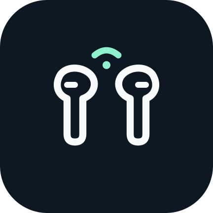

<p align="center">
  
</p>

# 耳机弹窗 · Earbuds Popup

蓝牙耳机连接后，在桌面或其它应用上方显示可自定义的耳机卡片。目前以 **HUAWEI FreeBuds 6i + vivo / iQOO** 为主要适配组合，使用 Android 原生 Java 实现。

**公开版只提供原创线条耳机示意，不内置华为或 vivo 的产品素材。可在应用内按型号导入自己的图片和动画。**

**[下载最新 APK](https://github.com/M1gr4ine/earbuds-popup/releases/latest)** · [v1.0.5 更新说明](docs/releases/v1.0.5.md) · [构建指南](docs/BUILDING.md)

## 功能

- **后台连接弹窗**：通过蓝牙连接事件和系统伴生设备关联触发，直接显示悬浮卡片，连接时无需打开设置界面。
- **按型号保存配置**：FreeBuds 6i、FreeBuds Pro 5 和未知设备分别管理；未知型号使用独立配置，可导入自己的素材。
- **导入静态或动态素材**：支持图片、GIF、WebP、MP4。导入后复制到应用私有目录，移动原文件后仍可使用。GIF / 动图在 Android 9 及以上使用系统动态解码。
- **外观调整**：位置、偏移、宽度、素材高度、圆角、底色、不透明度、图片裁切和视频速度；支持预览与恢复当前型号默认外观。
- **真实电量**：FreeBuds 6i 每次有效音频连接后自动查询左耳、右耳、充电盒电量。未获得的字段显示“未知”；电池图标跟随真实数值与充电状态。
- **按状态收起**：自动弹窗持续显示，直到检测到佩戴、连接断开或点击关闭。FreeBuds 6i 的佩戴状态通过只读蓝牙状态通道读取。
- **循环播放**：导入的视频和动图持续循环。素材按文件本身的帧顺序播放；想要同向、首尾自然衔接的效果，请导入已做好循环的素材。标题、关闭按钮和电量组件叠放在图片内部。
- **本地运行**：无需账号、Root 或无障碍服务。应用未申请联网权限，配置和导入素材保存在本地。

## 安装与启用

1. 从 [Releases](https://github.com/M1gr4ine/earbuds-popup/releases) 下载 `Earbuds-Popup-1.0.5.apk` 并安装。
2. 先在系统蓝牙设置里完成耳机配对，再打开“耳机弹窗”选择已配对设备。
3. 按系统提示授予蓝牙 / 附近设备权限，完成系统设备关联，并允许悬浮窗和通知。
4. 在 vivo / iQOO 的后台耗电管理中，把“耳机弹窗”设为 **允许后台耗电**；其它系统按各自的后台管理规则设置。
5. 如需产品图片或动画，先在“素材”中导入自己的文件，再点击 **启用监听**，回到桌面重新连接耳机。手动预览可用于调整外观，与监听开关独立。

启用监听后会保留前台服务通知。需要停止连接弹窗时，点击应用内“关闭监听”。若手动强制停止应用，需要重新打开并启用监听。

已有同签名版本可直接覆盖升级以保留设置。自行签名构建与 Releases 签名可能不同，Android 会阻止不同签名间的直接覆盖。

## 适配范围

| 项目 | 当前情况 |
| --- | --- |
| Android 要求 | 最低 Android 8.0 / API 26；目标 SDK 35 |
| 已实测组合 | iQOO 16 / OriginOS + HUAWEI FreeBuds 6i |
| FreeBuds 6i | 已验证后台连接弹窗、真实电量、佩戴收起；产品素材由用户导入 |
| FreeBuds Pro 5 | 已预留型号配置；素材、电量和佩戴协议尚未实机适配 |
| 其它耳机 | 可选择已配对设备并配置自定义素材；专有电量和佩戴检测需要逐型号适配 |

**盒盖行为**：当前没有独立的盒盖传感器接口。已实测合盖导致音频连接断开时卡片会收起；不能保证“耳机仍在连接”的所有合盖场景都会收起。

**后台与锁屏**：OriginOS 的后台策略可能延迟或冻结连接事件；已验证设备需要允许后台耗电。当前仅在亮屏且解锁时显示卡片。长期熄屏、重启恢复、其它手机系统和所有耳机固件组合仍需进一步验证。

**与智慧音频共存**：华为智慧音频可继续保留，用于音效预设等设置。本应用只发送电量、佩戴 / 入盒状态的读取请求，不修改耳机预设。蓝牙控制通道被占用或无响应时，电量可能显示未知，佩戴收起也可能暂时不可用；可手动关闭卡片。

## 素材导入

单个文件不超过 **40 MiB**；图片单边不超过 **4096 px**；视频单边不超过 **1920 px**、时长不超过 **60 秒**。实际可播放格式取决于系统解码能力。

自定义背景可通过“显示耳机本体”开关叠加独立耳机图，默认关闭。公开版需先使用“导入耳机透明图”选择已抠图的 PNG 或静态 WebP；耳机图需保留透明边距，可与背景分别更换、清除。FreeBuds 6i 的配套原视频可在包含本地素材的构建中循环旋转，并在 Android 13 及以上实时去除白底；公开 APK 不附带这套素材，导入的本体图片保持静态。

素材与外观按型号保存。导入素材默认裁切填满卡片，也可切换为完整显示。新型号没有匹配素材时不会套用 6i 图片。

## 开发

纯 Java + Android 系统 API，无 Gradle 或第三方运行时依赖。使用 JDK、Python 和本地 Android SDK 构建。

```sh
python scripts/build.py --test
python scripts/build.py --sdk /path/to/android-sdk --platform 36 --build-tools 37.0.0 --unsigned
```

默认输出未签名 APK 到 `dist/`。完整配置和可选签名方式见 [构建指南](docs/BUILDING.md)。

```text
app/src/                 蓝牙监听、设备配置、电量协议与原生卡片
app/res/                 主题与线条图标
app/assets/              素材使用说明；品牌素材由用户自行导入
app/tests/               六组纯 Java 测试
scripts/build.py         可移植构建脚本
```

v1.0.3 的验证范围和安装包校验值见 [验证记录](docs/VERIFICATION-v1.0.3.md)。反馈适配问题时，请说明手机系统、耳机型号 / 固件和复现步骤；提交日志前请移除设备地址、个人设备名称等信息。

## 素材与许可

这是独立个人项目，与 vivo、iQOO、华为没有隶属关系。品牌名称、商标和第三方产品素材归各自权利人。公开仓库和发布包均不包含品牌产品动画、第三方应用 APK 或私有资源包。

仓库暂未指定统一开源许可证，第三方素材不附带额外许可。具体来源见 [THIRD_PARTY_NOTICES.md](THIRD_PARTY_NOTICES.md)。
